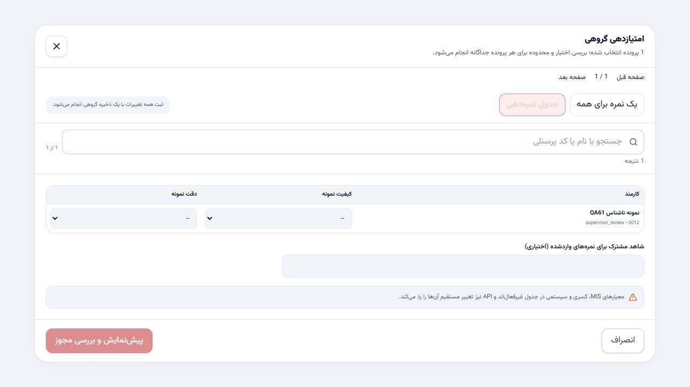

# CHALAK PERFORMANCE v6.1 — defect report
Date: 2026-10-13 (Asia/Tehran). **PARTIAL — BLOCKED BY CRITICAL DEFECT**. Production unchanged and unverified. Seven demonstrated defects fixed; one architectural data-loss blocker remains.

Base source SHA256: E730A3C643660FAD64D848DE480EC06CE581148C52E29F70D44E12DE6691817A
Base production SHA256: 234F2104CEE2E07E383B88444CD93586398A07E2E6F64F66D6276343A0B5A7EF
Both rechecked unchanged before packaging. New isolated source directory only.

The most important result is B01: two handlers reading a deliberately stale snapshot both accepted writes at the same revision and one change disappeared from actual isolated KV. This occurred for employee edits, personnel import versus manual scoring, and criterion edits. Stale reads were injected; persistence and subsequent reads used real Pages/KV. An ordinary two-process local control instead produced200/503 from local SQLite locking. Neither outcome claims observed production concurrency or a production1102 diagnosis.

Cloudflare documents that KV is eventually consistent and does not offer atomic transactions; serialization inside a Worker is insufficient across Workers. [Official KV consistency documentation](https://developers.cloudflare.com/kv/concepts/how-kv-works/). Proposed owner-reviewed next step: limited transactional authoritative save + operation receipt storage using a Durable Object (or properly transactional D1 design), with backup, invariants, rollback and separate deployment approval. No KV lock, migration, limit change or architectural rewrite was attempted here.

Preserved constraints: server permissions, source ownership, unrelated manual/supervisor/final records, violation policy defaults, independent approval and audit validation. Cross-period violations are rejected; source older than approved current data is not allowed to overwrite it. Header-based mapping avoids reordered column corruption. Completed evaluations use their snapshot. Sessions use active current registry identity. Invalid ACK/receipt cannot report success or trigger a blind POST. The storage blocker still prevents guaranteed audit/receipt/transaction integrity globally.

503 investigation: the existing conditional audit comparison optimization is present. Small request bytes and observed wall times are recorded; production Ray/CPU/memory logs were not available. No confirmed new CPU/memory hotspot justifies another speculative optimization. No claim that production1102 is eliminated.

Focused evidence and reproduction: [risk map](specs/v6.1-deep-defect-hunt/risk-map.md), [all eight defects](specs/v6.1-deep-defect-hunt/defects.md), [acceptance and limitations](specs/v6.1-deep-defect-hunt/acceptance.md). Before/after JSON and exact source patch in tests/evidence. Screenshot uses anonymous disposable QA personnel only.

## Changed application files
- src/components/PersonnelImport.tsx
- src/utils/db.ts
- src/utils/disciplinaryViolations.ts
- src/utils/evaluationPeriod.ts
- src/utils/formulaEngine.ts
- src/utils/personnelImport.ts
- functions/api/auth/login.ts
- functions/api/state.ts
- cloudflare/auth.ts
- cloudflare/operationReceipt.ts

Release metadata: package.json/package-lock.json version6.1.0; tsconfig excludes temporary probes; .specify/feature.json points to existing workflow's v6.1 folder; release-manifest.json marks productionReady:false. New Spec Kit contains exactly three records. Typecheck and Build passed once. The active application tree was cleaned by reversible quarantine of the synthetic KV environment, test adapter, random local credentials and scratch files. Automatic approval review rejected recursive deletion (blocked by policy); quarantine remains under .qa-quarantine and is excluded from both archives. Accepted v6 archives remain intact.

## Browser evidence

